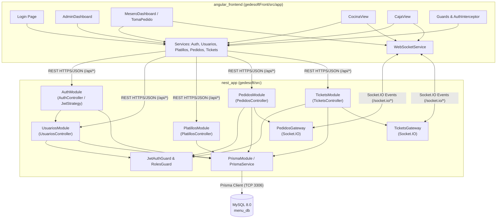

# C4 Level 3: Component Index & Architecture — Order Digital

## 1. Backend Components (`gedesoft/src`)

| Component | Source Location | Responsibility | Interfaces / Protocols | Dependencies |
|---|---|---|---|---|
| **App Bootstrap & CORS** | [main.ts](file:///c:/Users/lbavo/Documents/repos/order%20Digital/gedesoft/src/main.ts), [app.module.ts](file:///c:/Users/lbavo/Documents/repos/order%20Digital/gedesoft/src/app.module.ts) | Configures global `/api` prefix, Swagger UI (`/api`), CORS via `CORS_ORIGINS`, and root health/echo routes ([app.controller.ts](file:///c:/Users/lbavo/Documents/repos/order%20Digital/gedesoft/src/app.controller.ts)). | REST (`GET /api`, `POST /api/echo`) | `ConfigModule`, all feature modules |
| **AuthComponent (`AuthModule`)** | [auth.module.ts](file:///c:/Users/lbavo/Documents/repos/order%20Digital/gedesoft/src/modules/auth/auth.module.ts), [auth.controller.ts](file:///c:/Users/lbavo/Documents/repos/order%20Digital/gedesoft/src/modules/auth/auth.controller.ts), [jwt.strategy.ts](file:///c:/Users/lbavo/Documents/repos/order%20Digital/gedesoft/src/modules/auth/strategies/jwt.strategy.ts) | User registration, credential verification with `bcrypt`, and JWT signing/validation using `JWT_SECRET`. | REST (`POST /api/auth/register`, `POST /api/auth/login`) | `UsuariosModule`, `PrismaService`, `JwtModule` |
| **Security Guards (`AuthGuard` & `RolesGuard`)** | [jwt-auth.guard.ts](file:///c:/Users/lbavo/Documents/repos/order%20Digital/gedesoft/src/guards/jwt-auth.guard.ts), [roles.guard.ts](file:///c:/Users/lbavo/Documents/repos/order%20Digital/gedesoft/src/guards/roles.guard.ts), [roles.decorator.ts](file:///c:/Users/lbavo/Documents/repos/order%20Digital/gedesoft/src/decorators/roles.decorator.ts) | Enforces JWT authentication and role authorization across protected controllers. | NestJS ExecutionContext Guards | `@nestjs/passport`, `Reflector` |
| **UsuariosComponent (`UsuariosModule`)** | [usuarios.controller.ts](file:///c:/Users/lbavo/Documents/repos/order%20Digital/gedesoft/src/modules/usuarios/usuarios.controller.ts), [usuarios.service.ts](file:///c:/Users/lbavo/Documents/repos/order%20Digital/gedesoft/src/modules/usuarios/usuarios.service.ts) | CRUD management of `Usuario` accounts and password hashing. | REST (`POST /api/usuarios/create`, `GET/PUT/DELETE /api/usuarios/:id`) | `PrismaService`, `AuthGuard('jwt')`, `RolesGuard` |
| **PlatillosComponent (`PlatillosModule`)** | [platillos.controller.ts](file:///c:/Users/lbavo/Documents/repos/order%20Digital/gedesoft/src/modules/platillos/platillos.controller.ts), [platillos.service.ts](file:///c:/Users/lbavo/Documents/repos/order%20Digital/gedesoft/src/modules/platillos/platillos.service.ts) | CRUD management of menu dishes (`Platillo`), prices, availability, and `TipoCategoria`. | REST (`POST /api/platillos/create`, `GET/PUT/DELETE /api/platillos/:id`) | `PrismaService` |
| **PedidosComponent (`PedidosModule` + `PedidosGateway`)** | [pedidos.controller.ts](file:///c:/Users/lbavo/Documents/repos/order%20Digital/gedesoft/src/modules/pedidos/pedidos.controller.ts), [pedidos.service.ts](file:///c:/Users/lbavo/Documents/repos/order%20Digital/gedesoft/src/modules/pedidos/pedidos.service.ts), [pedidos.gateway.ts](file:///c:/Users/lbavo/Documents/repos/order%20Digital/gedesoft/src/modules/pedidos/pedidos.gateway.ts) | Order creation/updates, item removal, category pending queries, status transitions, and Socket.IO broadcasts (`nuevo_pedido`, `pedido_listo_notificacion`, `pedido_entregado_mesero`, `item_listo_notificacion`). | REST (`/api/pedidos/*`), Socket.IO | `PrismaService`, `AuthGuard('jwt')`, `RolesGuard` |
| **TicketsComponent (`TicketsModule` + `TicketsGateway`)** | [tickets.controller.ts](file:///c:/Users/lbavo/Documents/repos/order%20Digital/gedesoft/src/modules/tickets/tickets.controller.ts), [tickets.service.ts](file:///c:/Users/lbavo/Documents/repos/order%20Digital/gedesoft/src/modules/tickets/tickets.service.ts), [tickets.gateway.ts](file:///c:/Users/lbavo/Documents/repos/order%20Digital/gedesoft/src/modules/tickets/tickets.gateway.ts) | Payment ticket creation, listing, updates, and Socket.IO ticket notifications (`nuevo_ticket`, `ticket_listo_notificacion`). | REST (`/api/tickets/*`), Socket.IO | `PrismaService`, `AuthGuard('jwt')`, `RolesGuard` |
| **Data Access (`PrismaModule` / `PrismaService`)** | [prisma.module.ts](file:///c:/Users/lbavo/Documents/repos/order%20Digital/gedesoft/src/prisma/prisma.module.ts), [prisma.service.ts](file:///c:/Users/lbavo/Documents/repos/order%20Digital/gedesoft/src/prisma/prisma.service.ts) | Manages PrismaClient lifecycle and database connection pool via `DATABASE_URL`. | MySQL TCP (:3306) | `generated/prisma`, MySQL 8.0 |

## 2. Frontend Components (`gedesoftFront/src/app`)

| Component | Source Location | Responsibility | Interfaces / Dependencies |
|---|---|---|---|
| **Routing & Guards** | [app.routes.ts](file:///c:/Users/lbavo/Documents/repos/order%20Digital/gedesoftFront/src/app/app.routes.ts), [auth-guard.ts](file:///c:/Users/lbavo/Documents/repos/order%20Digital/gedesoftFront/src/app/auth/auth-guard.ts), [role-guard.ts](file:///c:/Users/lbavo/Documents/repos/order%20Digital/gedesoftFront/src/app/auth/role-guard.ts), [home.guard.ts](file:///c:/Users/lbavo/Documents/repos/order%20Digital/gedesoftFront/src/app/auth/home.guard.ts), [auth-interceptor.ts](file:///c:/Users/lbavo/Documents/repos/order%20Digital/gedesoftFront/src/app/auth/auth-interceptor.ts) | Protects `/admin`, `/mesero`, `/cocina`, `/caja`, redirects root via `homeGuard`, and attaches `Authorization: Bearer <token>` on HTTP requests. | `Auth` service |
| **Auth Service (`Auth`)** | [auth.ts](file:///c:/Users/lbavo/Documents/repos/order%20Digital/gedesoftFront/src/app/services/auth.ts) | Handles login/logout and browser-safe `localStorage` persistence (`token`, `user_role`). | `HttpClient` (`/api/auth/login`) |
| **Domain API Services** | [pedidos.ts](file:///c:/Users/lbavo/Documents/repos/order%20Digital/gedesoftFront/src/app/services/pedidos.ts), [platillos.ts](file:///c:/Users/lbavo/Documents/repos/order%20Digital/gedesoftFront/src/app/services/platillos.ts), [tickets.ts](file:///c:/Users/lbavo/Documents/repos/order%20Digital/gedesoftFront/src/app/services/tickets.ts), [usuarios.ts](file:///c:/Users/lbavo/Documents/repos/order%20Digital/gedesoftFront/src/app/services/usuarios.ts) | `PedidosService`, `PlatillosService`, `TicketsService`, and `UsuariosService` consuming `/api/*` via `environment.apiUrl`. | `HttpClient`, `authInterceptor` |
| **Realtime Client (`WebSocketService`)** | [web-socket.ts](file:///c:/Users/lbavo/Documents/repos/order%20Digital/gedesoftFront/src/app/services/web-socket.ts) | Browser-only Socket.IO wrapper (`emit`, `emitWithAck`, `listen`, `listenAll`) safe for Angular SSR. | `ngx-socket-io` |
| **Role Pages & Layout** | [main.ts](file:///c:/Users/lbavo/Documents/repos/order%20Digital/gedesoftFront/src/app/layout/main/main.ts), [login.ts](file:///c:/Users/lbavo/Documents/repos/order%20Digital/gedesoftFront/src/app/pages/login/login.ts), [admin-dashboard.ts](file:///c:/Users/lbavo/Documents/repos/order%20Digital/gedesoftFront/src/app/pages/admin/admin-dashboard/admin-dashboard.ts), [dashboard.ts](file:///c:/Users/lbavo/Documents/repos/order%20Digital/gedesoftFront/src/app/pages/mesero/dashboard/dashboard.ts), [toma-pedido.ts](file:///c:/Users/lbavo/Documents/repos/order%20Digital/gedesoftFront/src/app/pages/mesero/toma-pedido/toma-pedido.ts), [cocina-view.ts](file:///c:/Users/lbavo/Documents/repos/order%20Digital/gedesoftFront/src/app/pages/cocina/cocina-view/cocina-view.ts), [caja-view.ts](file:///c:/Users/lbavo/Documents/repos/order%20Digital/gedesoftFront/src/app/pages/caja/caja-view/caja-view.ts) | Standalone Angular components for authentication and each operational role view. | Frontend services + `WebSocketService` |

## 3. Component Relationships Diagram

