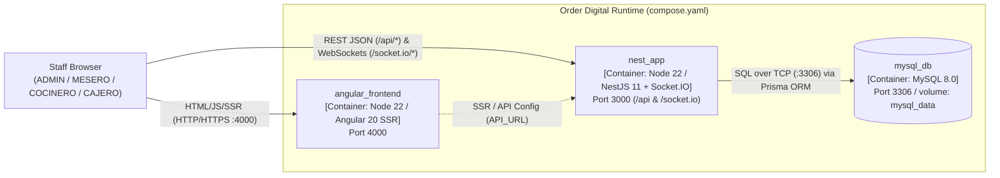

# C4 Level 2: Container Architecture — Order Digital

## 1. Containers Overview

The system is orchestrated with Docker Compose via [compose.yaml](file:///c:/Users/lbavo/Documents/repos/order%20Digital/compose.yaml) and consists of three runtime containers:

| Container | Service Name | Type | Technology | Deployment |
|---|---|---|---|---|
| **Frontend Web / SSR App** | `frontend` (`angular_frontend`) | Web Application (SSR + SPA) | Angular 20, Angular SSR, Express 5, `ngx-socket-io`, Node `22.17.0` | [gedesoftFront/Dockerfile](file:///c:/Users/lbavo/Documents/repos/order%20Digital/gedesoftFront/Dockerfile) (Port `4000`) |
| **Backend API & Realtime Server** | `backend` (`nest_app`) | API & WebSocket Server | NestJS 11, Express, Socket.IO 4, Prisma Client 6, Passport JWT, Node `22.17.0` | [gedesoft/Dockerfile](file:///c:/Users/lbavo/Documents/repos/order%20Digital/gedesoft/Dockerfile) (Port `3000`) |
| **Relational Database** | `db` (`mysql_db`) | Database | MySQL `8.0` with persistent volume `mysql_data` | `mysql:8.0` image in [compose.yaml](file:///c:/Users/lbavo/Documents/repos/order%20Digital/compose.yaml) (Port `3306`) |

## 2. Purpose & Deployment Details

### `angular_frontend`
- **Purpose:** Renders the multi-role SPA/SSR UI (`/login`, `/admin`, `/mesero`, `/cocina`, `/caja`), handles JWT interception (`authInterceptor`), guards routes by role (`authGuard`, `roleGuard`, `homeGuard`), and maintains a Socket.IO connection via `WebSocketService`.
- **Startup:** Built with `npm run build` and served via `npm run serve:ssr:mi-restaurante-frontend` on port `4000`.
- **Configuration:** Uses `environment.apiUrl` and `environment.socketUrl` (`/api` and `/` in production reverse-proxy setups, or `API_URL` in container environments).

### `nest_app`
- **Purpose:** Exposes all REST endpoints under the global prefix `/api` ([main.ts](file:///c:/Users/lbavo/Documents/repos/order%20Digital/gedesoft/src/main.ts#L22)), serves Swagger docs at `/api`, enforces JWT + Role guards, manages real-time Socket.IO gateways (`PedidosGateway`, `TicketsGateway`), and runs Prisma queries against MySQL.
- **Startup:** Runs `npx prisma migrate deploy && npm start` in [compose.yaml](file:///c:/Users/lbavo/Documents/repos/order%20Digital/compose.yaml#L39) after `db` reports `service_healthy`.
- **Environment Variables:** `DATABASE_URL`, `JWT_SECRET`, `JWT_EXP`, `CORS_ORIGINS`, `PORT`.

### `mysql_db`
- **Purpose:** Persists `Usuario`, `Platillo`, `Pedido`, `DetallePedido`, and `Ticket` tables defined in [schema.prisma](file:///c:/Users/lbavo/Documents/repos/order%20Digital/gedesoft/prisma/schema.prisma).
- **Healthcheck:** `mysqladmin ping -h localhost` (`timeout: 10s`, `retries: 5`, `start_period: 30s`).
- **Environment Variables:** `MYSQL_ROOT_PASSWORD`, `MYSQL_DATABASE`, `MYSQL_USER`, `MYSQL_PASSWORD` injected from `.env` (never committed).

## 3. Components per Container

- **`angular_frontend`:** Auth & Role Guards, HTTP Interceptor, Frontend Services (`Auth`, `PedidosService`, `PlatillosService`, `TicketsService`, `UsuariosService`, `WebSocketService`), Role Dashboards (`AdminDashboard`, `MeseroDashboard`, `TomaPedido`, `CocinaView`, `CajaView`, `Login`).
- **`nest_app`:** `AuthModule`, `UsuariosModule`, `PlatillosModule`, `PedidosModule`, `TicketsModule`, `PrismaModule`, `PedidosGateway`, `TicketsGateway`.
- **`mysql_db`:** `menu_db` relational schema managed by Prisma migrations.

See [c4-component.md](file:///c:/Users/lbavo/Documents/repos/order%20Digital/C4-Documentation/c4-component.md) for detailed component mapping.

## 4. Interfaces & API Specifications

- **REST API:** HTTP/JSON under `/api/*` documented in OpenAPI 3.1: [backend-api.yaml](file:///c:/Users/lbavo/Documents/repos/order%20Digital/C4-Documentation/apis/backend-api.yaml).
- **WebSocket API (`/socket.io/`):**
  - **Server -> Client events:** `nuevo_pedido`, `pedido_listo_notificacion`, `pedido_entregado_mesero`, `item_listo_notificacion`, `nuevo_ticket`, `ticket_listo_notificacion`.
  - **Client -> Server events:** `pedido_listo_notificacion`, `pedido_entregado_mesero`, `item_individual_listo`, `ticket_listo`.

## 5. Container Diagram

