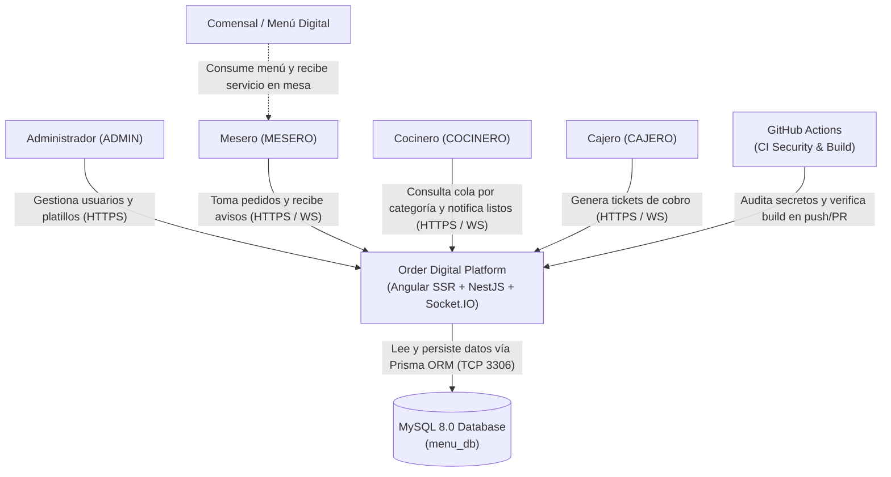

# C4 Level 1: System Context — Order Digital

## 1. System Overview

- **Short Description:** Order Digital is a real-time restaurant order management, digital menu, kitchen display, and billing platform built with Angular, NestJS, Socket.IO, Prisma ORM, and MySQL.
- **Long Description:** Order Digital coordinates daily restaurant operations across dining tables, waitstaff, kitchen preparation stations, cashiers, and administrators. Staff authenticate with role-based JWT tokens (`ADMIN`, `MESERO`, `COCINERO`, `CAJERO`) to manage dishes (`Platillo`), create and modify table orders (`Pedido`), synchronize kitchen preparation statuses in real time via WebSockets, and generate payment tickets (`Ticket`).

## 2. Personas

| Persona | Type | Description | Goals | Key Features Used |
|---|---|---|---|---|
| **Administrador (`ADMIN`)** | Human User | Restaurant manager with unrestricted access across all routes. | Configure staff accounts, maintain the dish catalog, oversee orders and billing. | User CRUD, Platillos CRUD, full dashboard access. |
| **Mesero (`MESERO`)** | Human User | Dining-room waitstaff taking orders by table. | Create/update table orders, receive real-time "order ready" notifications, deliver dishes. | Mesero dashboard, Toma-Pedido view, real-time notifications, order delivery updates. |
| **Cocinero (`COCINERO`)** | Human User | Kitchen preparation staff organized by dish category (`ENTRADA`, `PLATO_FUERTE`, `BEBIDA`, `POSTRE`, `OTRO`). | View incoming pending dishes by category and notify waitstaff when items/orders are ready. | Category-filtered kitchen queue, item/order ready Socket.IO emissions. |
| **Cajero (`CAJERO`)** | Human User | Cashier responsible for checkout and payment records. | Generate payment tickets for completed orders and review billing history. | Caja dashboard, ticket generation (`EFECTIVO`, etc.), billing totals. |
| **Comensal / Menú Digital** | Human User (Stakeholder) | Restaurant guest whose dining-table orders and catalog items are managed through the digital menu catalog (`Platillo`). | Browse available dishes, pricing, and categories served at their table (`numMesa`). | Menu catalog (`Platillo` availability, pricing, category filtering). |

## 3. System Features

1. **Autenticación y Control de Acceso (RBAC):** JWT authentication (`/api/auth/login`, `/api/auth/register`) with `AuthGuard('jwt')` and `RolesGuard`, plus Angular route guards (`authGuard`, `roleGuard`, `homeGuard`).
2. **Gestión de Usuarios y Catálogo de Platillos:** CRUD operations for staff (`Usuario`) and menu items (`Platillo`) with `TipoCategoria` (`ENTRADA`, `PLATO_FUERTE`, `BEBIDA`, `POSTRE`, `OTRO`).
3. **Toma y Edición de Pedidos por Mesa:** Create table orders (`Pedido` + `DetallePedido`), append dishes, remove dishes, or transition `StatusPedido` (`PENDIENTE`, `ENTREGADO`, `CANCELADO`).
4. **Sincronización en Tiempo Real (Cocina ↔ Mesero ↔ Caja):** Bidirectional Socket.IO events (`nuevo_pedido`, `pedido_listo_notificacion`, `pedido_entregado_mesero`, `item_individual_listo`, `item_listo_notificacion`, `nuevo_ticket`, `ticket_listo`, `ticket_listo_notificacion`).
5. **Facturación y Tickets:** Generate `Ticket` records linked 1:1 (`idPedido` unique) to orders with payment method and calculated totals.

## 4. User Journeys

### Toma de Pedido y Cocina — `MESERO` & `COCINERO` Journey
1. **Login:** `MESERO` signs in via `/login` (`POST /api/auth/login`) and receives a JWT + role redirect to `/mesero`.
2. **Toma de Pedido:** `MESERO` selects a table (`numMesa`) in `MeseroDashboard` -> `TomaPedido`, picks dishes from `PlatillosService`, and submits `POST /api/pedidos/create`.
3. **Broadcast:** Backend saves `Pedido` + `DetallePedido` in MySQL via Prisma and emits `nuevo_pedido` via `PedidosGateway`.
4. **Preparación:** `COCINERO` views pending items by category (`GET /api/pedidos/pendientes/:categoria`) in `CocinaView` and emits `item_individual_listo` / `pedido_listo_notificacion`.
5. **Entrega:** `MESERO` receives `item_listo_notificacion` / `pedido_listo_notificacion`, delivers the order, updates status (`PATCH /api/pedidos/:idPedido/estado`), and emits `pedido_entregado_mesero`.

### Cobro de Cuenta — `CAJERO` Journey
1. **Revisión:** `CAJERO` views active/delivered orders in `CajaView` (`GET /api/pedidos`).
2. **Generación de Ticket:** `CAJERO` submits `POST /api/tickets` with `idPedido` and `metodoPago`.
3. **Confirmación:** `TicketsService` persists the `Ticket` in MySQL and `TicketsGateway` broadcasts `nuevo_ticket`.

### Administración — `ADMIN` Journey
1. **Gestión de Personal y Menú:** `ADMIN` opens `/admin` (`AdminDashboard`) to create/edit/delete staff (`Usuario`) via `/api/usuarios` and dishes (`Platillo`) via `/api/platillos`.

## 5. External Systems and Dependencies

| System | Type | Description | Integration Type | Purpose |
|---|---|---|---|---|
| **MySQL 8.0 (`mysql_db`)** | Relational Database | Stores `Usuario`, `Platillo`, `Pedido`, `DetallePedido`, and `Ticket`. | TCP/3306 via Prisma ORM (`DATABASE_URL`) | Persistent transactional storage. |
| **GitHub Actions CI/CD** | Automation Platform | Runs security/secret checks and build verification on push/PR. | `.github/workflows/ci-security.yml` | Prevents secret leaks and broken builds before deployment. |
| **Google Fonts (`Poppins`)** | External CDN | Supplies webfont assets referenced in the frontend bundle. | HTTPS | UI typography rendering in browser. |

## 6. System Context Diagram

## 7. Related Documentation

- [Container Documentation](file:///c:/Users/lbavo/Documents/repos/order%20Digital/C4-Documentation/c4-container.md)
- [Component Index](file:///c:/Users/lbavo/Documents/repos/order%20Digital/C4-Documentation/c4-component.md)
- [Backend OpenAPI Spec](file:///c:/Users/lbavo/Documents/repos/order%20Digital/C4-Documentation/apis/backend-api.yaml)
